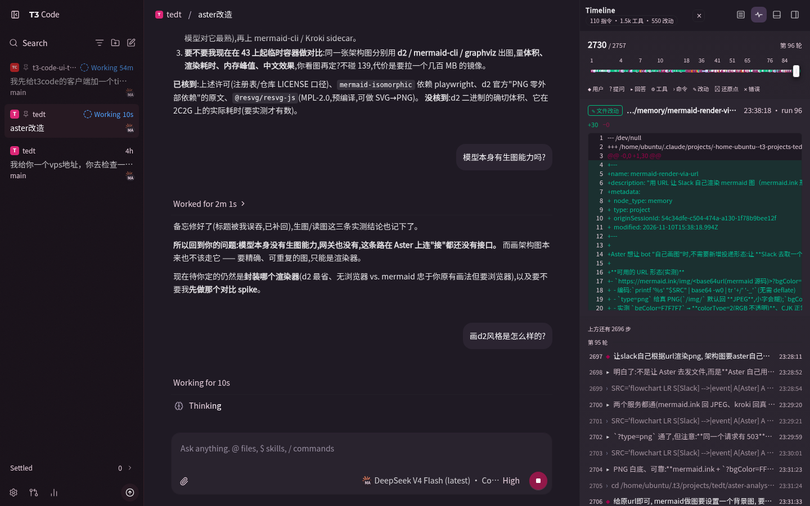
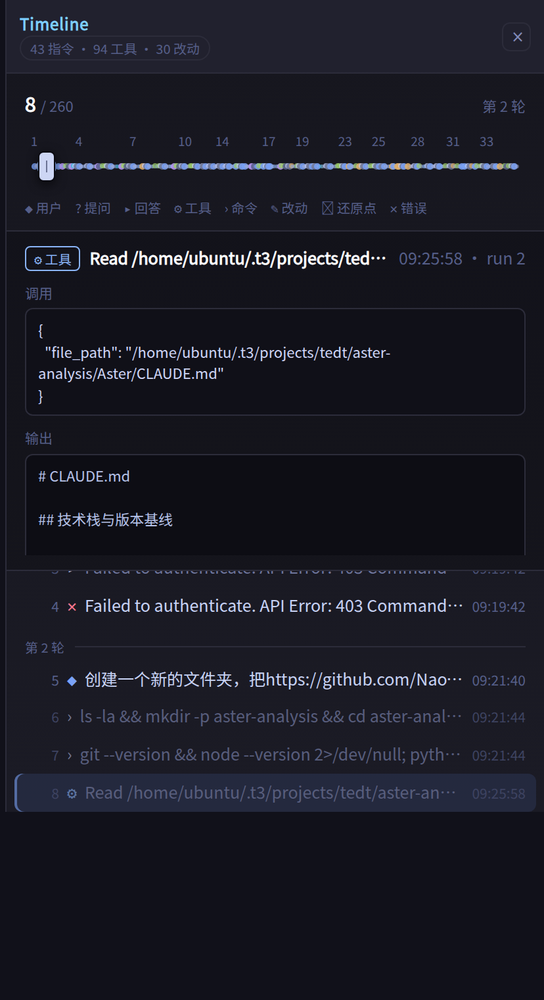
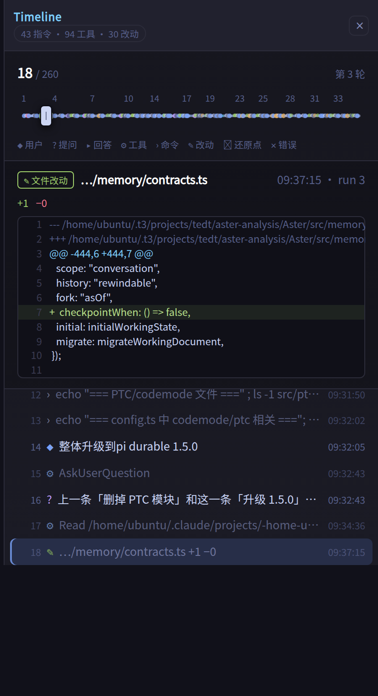
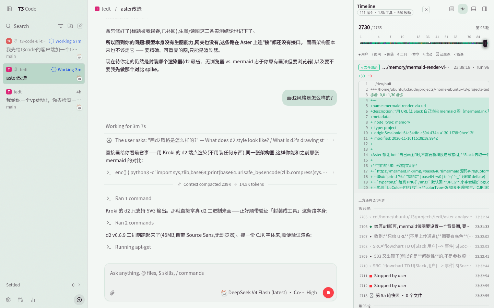
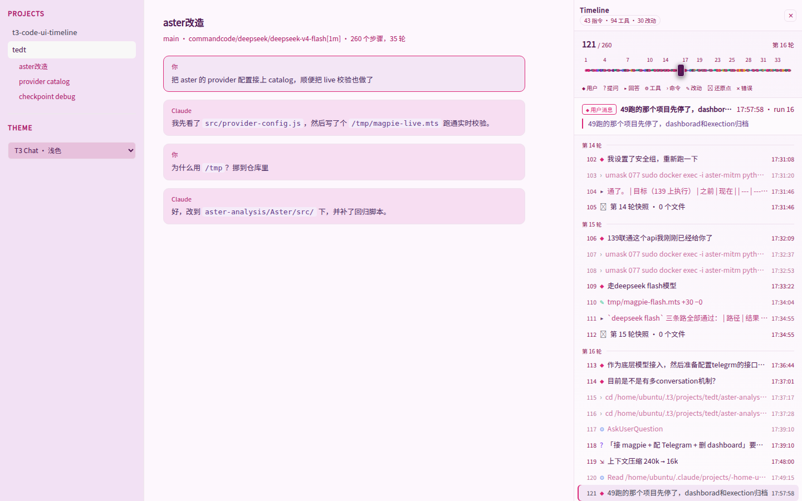

# t3-code-ui-timeline

A **Timeline** panel for the T3 Code client: one scrubbable track over a task's
whole life — what you asked for, every answer and question, every tool call with
the arguments it was given and the output it returned, every file change with its
diff, every restore point, every interruption and failure. Drag the playhead and
the step under it opens: the decision as it was made, the call as it was run.

It is not a separate app and not a separate page. It docks as a column beside
the thread's chat, and its toggle is a clone of T3 Code's own toolbar button, so
it inherits the app's styling and sits in the app's own control group:


and it is painted by whichever theme the app is wearing — here T3 Chat, dark:



`docs/toolbar-button.png` is a close-up of the top-right corner: the panel's own
close button in its header, then T3 Code's control group — the pulse icon
(highlighted, because the panel is open) sits between T3 Code's own buttons.

## What a step is

Every turn item the model produced **except its private reasoning** — reasoning
is the one type left out, on purpose: it is the model talking to itself and it
outnumbers everything else (1379 of the thread's 3907 items). The other 17 types
all become steps, in three tiers so the track stays readable:

| tier | steps | why |
| --- | --- | --- |
| 0 | user message, question, secret request, plan, approval, checkpoint, compaction, interruption, error | a decision or a boundary — bright dots on the track |
| 1 | answer, subagent, file change, notification | a detail of one |
| 2 | tool, command, web search | texture, of which there are hundreds |

The thread this was built against carries **2624 steps over 85 turns** — `97
指令 · 1.4k 工具 · 542 改动` in the header. Dragging the playhead is the point:
the list beside it is a window of ±60 steps around wherever you are, because
laying out two and a half thousand rows costs ~335ms (against ~25ms for a
window). Dragging within the window repaints in 0.2ms a step; the list is only
scrolled when the selected row has actually left view.

What a step opens to — a tool call, with the arguments it was given and the
output it came back with; and a file change, with its diff:





## The style: it wears the app's theme

Nothing about the panel's colours is its own when T3 Code is behind it, and
nothing is copied either — there is no palette to keep in sync and no listener
watching for a theme change. T3 Code paints its colours onto the root element as
custom properties, custom properties inherit across a shadow boundary, so the
panel simply reads them.

Two sources, in this order:

| when | what the app sets | what the panel reads |
| --- | --- | --- |
| a theme is chosen — the six cards in Settings → Appearance (T3 Code, T3 Chat, Grove, Ocean, Ember, Iris) or a user theme in `~/.t3/userdata/themes` | ~61 `--app-theme-*` properties, written inline on `<html>`, plus `data-theme-id` | `--app-theme-surface`, `--app-theme-text`, `--app-theme-accent`, `--app-theme-toolbar`, `--app-theme-border`, `--app-theme-code-background`, … |
| no theme — T3 Code's default black-and-white, and what "T3 Code" in that grid is | its own resolved `--background`, `--card`, `--foreground`, `--border`, `--muted`, `--accent`, `--primary`, `--toolbar-background`, `--code-foreground`, … | the same names, as the second link of each `var()` chain |

So every chrome colour follows the app — surfaces, borders, text, the muted
greys, the selection fill, code blocks, the scrollbar, and your own messages
take the accent. The diff colours follow too, because the app derives them from
its own tokens: `--diff-addition` is a fixed emerald, `--diff-deletion` is
`--destructive`, which is the theme's error colour. Change the theme, change the
appearance, drop a user theme file in — the panel repaints, because nothing was
ever copied out.

**Appearance** is asked of the app rather than guessed: T3 Code's `useTheme`
toggles a `dark` class on `<html>`, and its stylesheet is written against that
class, so that is what the panel looks at. If a host doesn't say, the panel reads
the canvas colour's lightness — through a 1×1 canvas, because the app's colours
are `oklch()` as often as hex, and only rendering one says how light it is — and
failing that, the system preference, which is the app's own last resort as well.
The answer matters for the handful of things a theme has no token for.

**What deliberately does not follow the theme** is the step *kinds*. A theme
names one accent and there are seventeen kinds of step, so the roles the theme
does have an answer for take it, and the rest are five fixed hues, chosen to be
distinct from one another and legible on either appearance:

| kind | colour |
| --- | --- |
| user message | the theme's accent |
| answer | the theme's text |
| file change | the diff's own green |
| notification, secret request | the theme's warning |
| error, interruption | the theme's error |
| plan, question | `#bb9af7` (fixed) |
| tool | `#8ab4f8` (fixed) |
| search, subagent, approval | `#2ac3de` (fixed) |
| checkpoint | `#6b7394` (fixed) |
| command | `#a9b1d6` (fixed) |

Those five flip to darker variants on a light appearance (`#7c3aed`, `#2563eb`,
`#0e7490`, `#71717a`, `#52525b`), which is all the light block in the panel's
stylesheet does — every app-driven value above it is the app's to resolve. For
anything else, the panel's own fallback palette is the third link in each chain:
what it wears when it is running against the demo, or in a page that is neither
T3 Code nor themed.

The panel's own toggle is the app's button, cloned, so its styling was never
ours to get wrong: it arrives with the app's classes, inherits the control
group's colours, and its pressed state is the same `aria-pressed` the app's own
panel toggles use.

and under Grove, light, a third palette entirely:



The demo harness is where this is exercised: it writes a theme's real palette
onto its root element the way the app does, offers all six cards plus both
appearances plus the panel's own palette, and `scripts/extract-themes.py` pulls
those palettes out of the app's bundle so the demo applies genuine ones.
`docs/panel.png` is the demo with T3 Chat, light — the page around the panel and
the panel itself are the same palette, and neither was told about the other.

## Why this is small

Almost nothing had to be invented. T3 Code already records and serves the whole
process; this project only filters it down to what a human wants and draws it.
What is reused, verified against T3 Code **0.1.7**:

| Need | Already in T3 Code |
| --- | --- |
| The process, as data | event-sourced store `orchestration_v2_events` + projections `orchestration_v2_projection_*` in `~/.t3/userdata/statev2.sqlite` |
| An ordered timeline | `OrchestratorV2.getTimelinePage`, index table `orchestration_v2_turn_item_positions`, `ProjectionStore.readTimelineIndex` |
| The steps themselves | turn items: `user_message`, `assistant_message`, `reasoning`, `proposed_plan`, `tool_call*`, `command_execution`, `file_change`, `subagent`, `web_search`, `approval_request`, `user_input_request`, `secret_request`, `notification`, `compaction`, `run_interrupt_*`, `checkpoint`, `error` |
| A file change's diff | `orchestration.getTurnItem` returns the item with its `diffStr` |
| A tool call's output | the same call — the projection carries an item's metadata, not its output |
| A turn's diff | `orchestration.getTurnDiff { threadId, fromTurnCount, toTurnCount }` |
| Live updates | `orchestration.subscribeThread` (snapshot + event stream), `subscribeShell`, `subscribeCommandOutput` |
| Restore points | a git ref per turn: `refs/t3/orchestration-v2/checkpoints/<scope>/ordinal/<n>` |
| The connection | effect-RPC over `/ws` with **plain-JSON** frames |

The one thing T3 Code does *not* have is a plugin API: the client is a prebuilt
bundle with a hardcoded right-panel union (`diff`, `files`, `preview`, `file`,
`device`, `side-chat`, …). So this panel is **injected**: one script tag added
to the client's `index.html` plus a few files dropped into its `assets/`. The
alternative — a WebSocket client of its own, instead of injection — is what
`src/t3-rpc.js` is; the ticket handshake, the framing and the streaming took one
file.

## The pieces

```
install.mjs            patch / unpatch the T3 Code client (backs up index.html)
src/t3-timeline.js     entry point: follows the SPA route, subscribes, feeds the panel
src/t3-integration.js  dock the panel in the thread page and clone its toolbar toggle
src/t3-rpc.js          the T3 WebSocket client (ticket auth + JSON RPC frames)
src/timeline-core.js   which turn items become steps; shaping, stats, diff parsing
src/panel.js           the panel itself (shadow DOM, no build step)
demo/index.html        standalone harness that renders the panel from a fixture
scripts/make-fixture.py  captures a fixture out of the local sqlite, read-only
scripts/extract-themes.py  reads the app's built-in theme palettes out of its bundle
```

## Use it

```sh
node install.mjs            # patch the running client (idempotent)
node install.mjs --status   # what is installed
node install.mjs --uninstall
```

Then hard-reload the T3 Code window, open a thread, and click the pulse icon in
the thread header. Drag the playhead (or click a coloured dot, or a row in the
list) to move through the task; `⌘/Ctrl+Shift+T` shows and hides the panel, and
with the panel focused `←`/`→` step one step at a time, `Home`/`End` go to the
ends of the task.

Note: `t3 update` replaces the client, so re-run `node install.mjs` afterwards.

### On Windows

Nothing in the panel is platform-specific — it is browser-side script plus one
Node installer — and T3 Code resolves its data directory to `<home>/.t3` on every
platform, serving the client from
`<data dir>/runtime/versions/<version>/client`, the folder that also holds the
server binary. So the same three steps work:

```powershell
node install.mjs            # from the repo root, in PowerShell or cmd
node install.mjs --status   # client dir, patched?, which assets
node install.mjs --uninstall
```

- **Node 20.11 or newer** — the installer uses `import.meta.dirname`.
- The client is expected at
  `%USERPROFILE%\.t3\runtime\versions\<version>\client`. `node install.mjs
  --dry-run` prints what it resolved before changing anything;
  `--client-dir "C:\path\to\client"` overrides it, and so does `T3CODE_HOME`.
  If a bundled installation puts the client somewhere else, this finds it:

  ```powershell
  Get-ChildItem "$env:USERPROFILE\.t3" -Recurse -Filter index.html -EA SilentlyContinue |
    Where-Object { $_.DirectoryName -like "*client*" } | Select-Object FullName
  ```
- An installation under `C:\Program Files` needs an Administrator prompt to
  patch; `%USERPROFILE%\.t3` does not.
- Reload the window with `Ctrl+R` (`Ctrl+Shift+R` to skip the cache). `t3 update`
  replaces the client, so re-run `node install.mjs` after one.
- Chinese in a tool's output stays readable: the panel's font stack names
  `Microsoft YaHei` after the monospace family.
- The fixture script is the only Python in the repo, so it is `python`, not
  `python3`: `python -I scripts\make-fixture.py > demo\fixture.json`. The demo
  page is plain static files — `python -m http.server 8791`, then open
  `http://127.0.0.1:8791/demo/index.html`.
- Inside WSL, use the Linux instructions instead: there the paths are POSIX and
  so is the T3 Code installation it patches.

### Docking, and getting out of the app's way

The panel becomes a column in the thread page's own layout row, right of the
chat, so the chat makes room for it rather than being covered. Four things about
that are worth knowing, all of them found by measuring the live DOM in a
headless browser:

- **The chat column is found by walking up from the toolbar**, not by taking the
  row's first child. "First div" breaks as soon as the client opens one of its
  own right-hand panels, and it also matches our own host once that is in the
  row — which would make each placement depend on the previous one.
- **T3 Code floats its thread controls** in a `position: fixed`, `z-50` group
  pinned to the viewport's top-right corner, over whichever panel is docked
  there. Docked, the panel therefore drops its own z-index and lets the app's
  chrome stay on top — otherwise it would swallow the very buttons its toggle
  was cloned from.
- **The header measures that group and insets itself around it** (a custom
  property handed to CSS), because the group also moves when a sidebar opens or
  the window narrows. A hard-coded width would be wrong at both ends: the group
  is 124px wide at a 1500px window — and `Maximize panel` hangs off it with
  `absolute right-full`, outside its box, which is why the strip measured is the
  union of the group and its buttons (177px in that window, not 137px).
- **The host element's own inline styles are only ever set one property at a
  time.** Assigning `style.cssText` for the docked layout would be simpler and
  would also throw away anything the page had already put inline on that element
  (a font variable, typically — the one that makes the panel legible on a
  machine with no CJK fonts).

## How it talks to T3 Code

A browser cannot set headers on a WebSocket, so T3 Code splits the handshake:
the credential (the page's own session cookie) is exchanged over HTTP for a
one-time ticket, and the protocol version rides in the query string.

```
POST /api/auth/websocket-ticket           -> { ticket }
ws://host/ws?orchestrationProtocol=2&wsTicket=<ticket>
-> { "_tag":"Request", id, tag, payload, headers: [] }
<- { "_tag":"Chunk", requestId, values: [...] }     (streaming)
<- { "_tag":"Exit",  requestId, exit: {...} }
```

The panel subscribes with `orchestration.subscribeThread` and reads the first
`snapshot`, whose `projection.visibleTurnItems` is already in timeline order.

Two things about that snapshot shape the rest of the panel:

- **It is a window, not the thread.** The client hands out the recent items —
  a 77-item window on the thread this was built against, and the *same* window
  on every re-sync. Replacing the panel's list with each update would quietly
  drop the earlier history the panel exists to scrub through, so updates are
  merged by item id and ordered by `item.ordinal`, which is global to the thread
  and therefore comparable between a full snapshot and a window.
- **It carries metadata, not substance.** No `diffStr` on a file change, no
  `output` on a tool call — those read `+0 −0` and `[object Object]` if you
  trust the projection. Both are fetched per step, once, when that step is first
  selected: `orchestration.getTurnItem({ threadId, itemId })`. The results are
  kept in a map and re-applied after every re-sync, since a re-sync rebuilds
  every node from scratch.

A restore point goes one step further: its own `files` list is a snapshot that
is usually empty — 8 of the 100 checkpoints on this thread have one — so its
detail shows the *turn's* changes instead, from
`getTurnDiff({ threadId, fromTurnCount: turn − 1, toTurnCount: turn })`, and
says so in the summary rather than passing one off as the other.

Two things the panel does to keep a step legible once it has them: a tool's
output is normalised out of whatever shape it arrived in (a file read comes back
as `{ type, file: { filePath, content } }`, an MCP tool as content blocks),
because rendering the object itself gets the reader `[object Object]`; and a
command's summary drops the `cd <project> &&` it almost always opens with, which
is the same directory every time and eats the whole row.

## The demo

The same panel also runs against a captured fixture, which is how it was
developed and how `docs/panel.png` was taken:

```sh
python3 -I scripts/make-fixture.py > demo/fixture.json   # refresh from local data
python3 -I scripts/extract-themes.py > demo/themes.json  # the app's own palettes
python3 -m http.server 8791
# http://127.0.0.1:8791/demo/index.html?theme=T3%20Chat
```



The demo docks the panel into a stand-in layout of its own, so the shot shows
the real thing; the difference is who owns visibility. Inside T3 Code the host
reactivates the panel from its toolbar toggle, while in the demo the panel owns
it. The theme picker in its sidebar applies a real palette (or the app's default
look, or nothing at all) to the page's root element, `?theme=<label prefix>`
starts on one of them, `?i=<n>` selects a node by index and `?type=file_change`
selects the first of a kind. The fixture is a *sample* — every decision and boundary, and a few of each
turn's tool calls — because the full thread is 2600 steps and half a megabyte of
diffs; the script says which. The `demo/fonts/` CJK font is only there so the
panel is legible on machines without CJK system fonts.

## Not done yet

- **Paging back past the snapshot window.** Merging keeps whatever the panel has
  seen, but a freshly-opened long thread only ever sees the client's window;
  `getTimelinePage` with `afterPosition` is what would backfill the rest.
- **A list that scrolls the whole history.** The list is a window around the
  playhead; reaching a step a thousand back means dragging the track. A
  virtualised list would let the list itself scroll end to end.
- **Picking the diff apart** — `parseDiff` numbers the lines of a whole git diff,
  so a multi-file change gets one continuous line numbering rather than a fresh
  count per file.
- **Filtering.** Two and a half thousand steps is a lot of texture; a tier
  toggle (`只显示决策`) would make the list worth scrolling.
- **The app's own accent choices.** The panel takes the theme's accent for your
  messages, but T3 Code also has separate tokens for a message's action button
  and a secondary label that a richer panel could use rather than a fixed hue.
