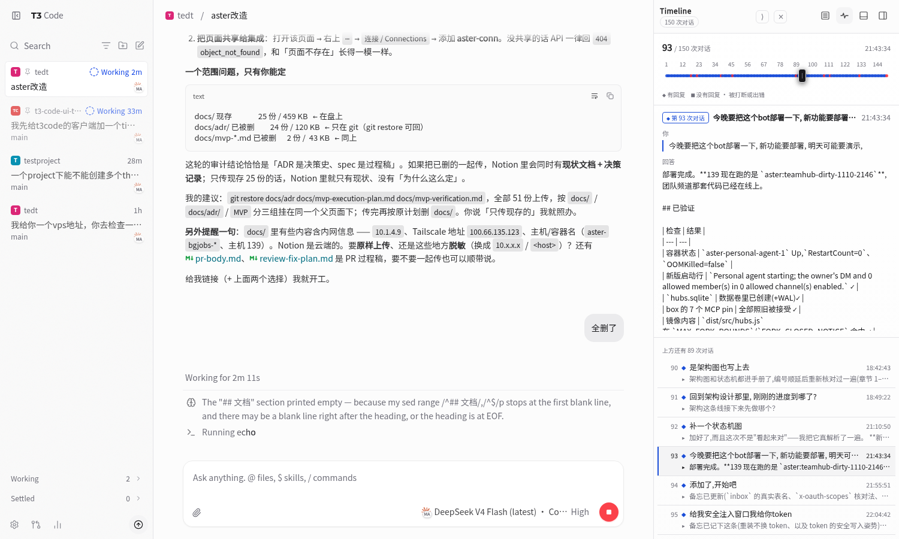
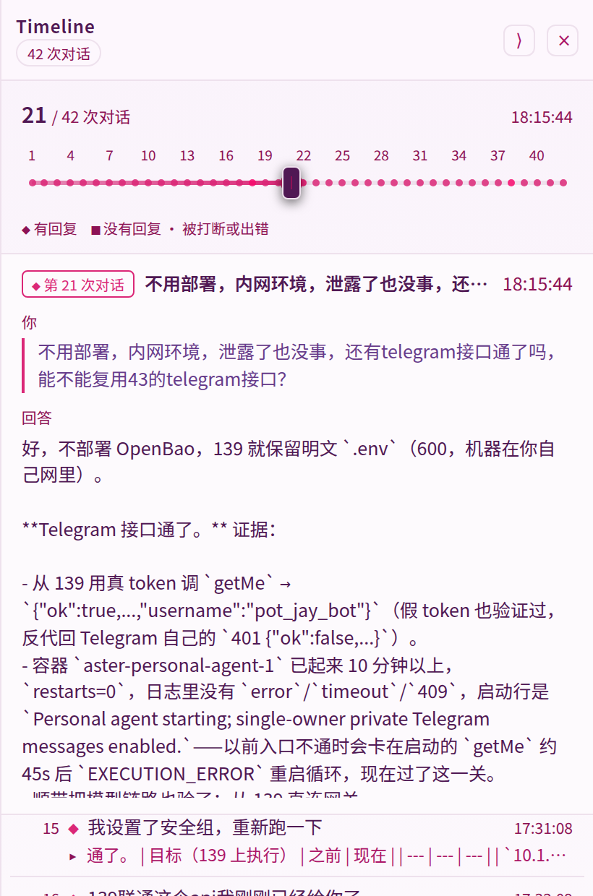
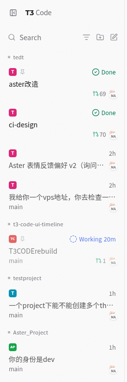
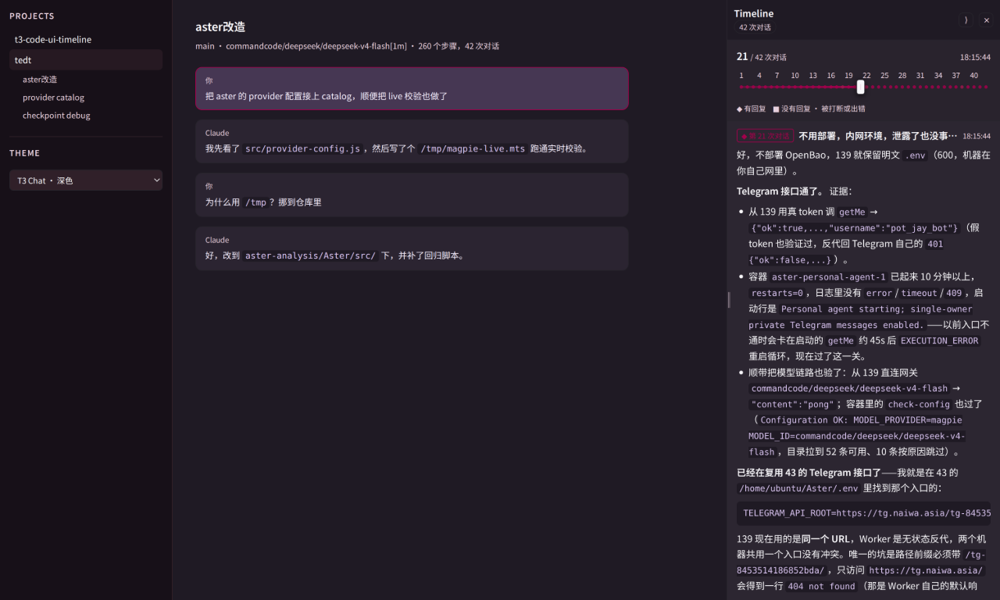
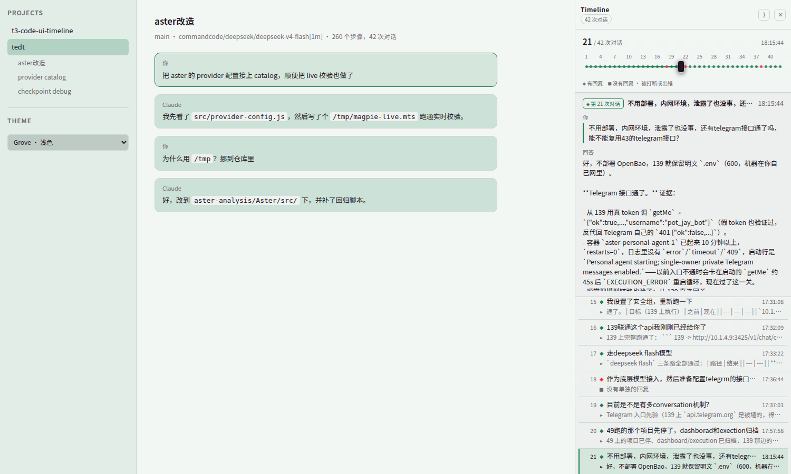
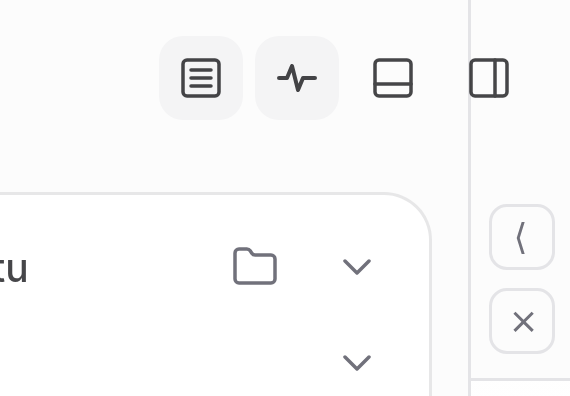

# t3-code-ui-timeline

A **Timeline** panel for the T3 Code client: one scrubbable track over a task's
whole life, **bounded by what you asked for**. One user message opens a
conversation and the next one closes it; everything in between — the tool calls,
the commands, the file changes and their diffs, the asides on the way — is
counted and folded away, and what the panel shows for each conversation is the
question and the agent's last word on it. Drag the playhead and that pair opens:
what you asked, in your own words, and what came of it.

It is not a separate app and not a separate page. It docks as a column beside
the thread's chat, and its toggle is a clone of T3 Code's own toolbar button, so
it inherits the app's styling and sits in the app's own control group:



## What a conversation is

The thread this was built against is **3.5k steps long, over 150
conversations** — 5347 items, 1821 of them the model's private reasoning, the
rest the record of what it did. Reading a task back is not reading the middle of
that, so the panel draws the ends:

| | |
| --- | --- |
| **the boundary** | a user message. It opens a conversation, and the next user message closes it. |
| **the end** | the last thing the agent put in front of the user before that next message: an answer, a question, an ask for a key, an ask for permission. On this thread that is 135 answers, 5 asks for a key and 1 question — and 9 conversations that ended on nothing at all. The label over it says which kind of last word it was. |
| **what is folded away** | everything else: tool calls, commands, file changes and their diffs, plans, subagent transcripts, checkpoints, compactions. 3376 steps fold into those 150 conversations, and one conversation's middle runs to 360 of them. They are counted, not shown — nothing in the panel is a diff or a tool call any more. |

What one conversation opens to, then its neighbours below it:



A conversation with nothing to show says which kind of nothing it is, and — unless
it is simply still being worked on — takes the error colour on the track rather
than the accent:

- **`没有单独的回复`** — the agent put nothing in front of the user before the
  next message. This is usually benign: sending a follow-up while a run is still
  working opens the next conversation, and the answer that run eventually
  produced closes *that* one, leaving this one with nothing at the moment it was
  asked.
- **`这一轮被打断，没有回复`** and **`这一轮出错，没有回复`** with the failure's own words
  — an interrupt or a failure *ends* the conversation when it came after the
  agent's last word. One that came before it stopped the work whose answer opens
  the next conversation, so it is that one's to report; the data says which, not
  the panel.
- **`正在回复…`** — the work is in flight. An item still marked `running` is the
  signal, and only the last conversation is allowed to use it (one run works at a
  time, so a `running` item further back is stale — a run killed mid-item leaves
  one — and a conversation that claimed to be answering forever would be worse
  than one that says nothing).

A conversation that was answered and *then* interrupted shows both: the answer,
and a muted line under it — `这之后被打断 · Stopped by user`. 7 of the 150 have one.

Steps before the first user message (a run woken by a notification, say) belong
to no conversation and are left out.

**The numbers on the ruler count conversations, not runs.** This thread has 150
conversations against 139 runs, because everything you send while a run is still
working splits that run into two. The run ordinal is what T3 Code keys turn
diffs and restore points by (`run:thread:<id>:ordinal:<N>`) and it is not the
number on the ruler, so the panel does not show run numbers anywhere.

`src/timeline-core.js` still shapes *every* kind of step, and still knows what a
file change's diff or a tool call's output looks like. That is the layer that
decides what a step is; `conversations()` is the fold on top of it, and it is
what the panel is handed.

## Threads grouped under their project

The same script also re-sorts the client's sidebar, so threads from one project
sit together under a heading for that project:



T3 Code **0.1.7 does not do this itself**. Its sidebar is a single list sorted by
recency, and every card repeats its project's name in small type — on this
machine 23 of the 27 threads are in one project, so that name is on 23 cards out
of 27 and the list still does not say which threads belong together. The app does
have a per-project *filter* (the funnel next to the search box), and
`sidebarProjectGrouping-*.js` groups *projects* that share a repository across
environments — but nothing nests threads under a project.

The grouping is applied to the rendered list rather than to the app's data:

- **Nothing the app owns is moved.** The list is a flex column, so CSS `order`
  re-sorts the cards without touching the DOM; the only nodes added are heading
  `li`s, which React never sees and never removes.
- **Inside a project the cards keep the app's order** (newest first), and
  projects are ordered by their most recent thread, so the top of the list is
  still the newest thing that happened.
- **A card's project is not in the DOM.** Rows carry no project attribute; the
  name comes from the React props the row was rendered from (`thread`,
  `project`, `projectDisplayName`), reached through the `__reactFiber$` property
  React leaves on every element. If that ever stops working the list simply goes
  back to being flat — the app's own look.
- **The project group's name is what groups them**, not the project folder: the
  app can show one group across several environments, and the heading says what
  the cards used to say. The per-card copy is then hidden, since the heading
  covers it; the project's icon stays.
- The zero-height dividers the app inserts between recency buckets are hidden —
  they mean nothing once the order is by project.

Two ways off, if you would rather have the app's flat list:
`localStorage['t3sidebar:group'] = '0'` and reload, or add `?t3NoSidebarGroup` to
the client's URL.

## The style: it wears the app's theme

Nothing about the panel's colours is its own when T3 Code is behind it, and
nothing is copied either — there is no palette to keep in sync and no listener
watching for a theme change. T3 Code paints its colours onto the root element as
custom properties, custom properties inherit across a shadow boundary, so the
panel simply reads them.

Two sources, in this order:

| when | what the app sets | what the panel reads |
| --- | --- | --- |
| a theme is chosen — the six cards in Settings → Appearance (T3 Code, T3 Chat, Grove, Ocean, Ember, Iris) or a user theme in `~/.t3/userdata/themes` | ~61 `--app-theme-*` properties, written inline on `<html>`, plus `data-theme-id` | `--app-theme-surface`, `--app-theme-text`, `--app-theme-accent`, `--app-theme-toolbar`, `--app-theme-border`, `--app-theme-code-background`, … |
| no theme — T3 Code's default black-and-white, and what "T3 Code" in that grid is | its own resolved `--background`, `--card`, `--foreground`, `--border`, `--muted`, `--accent`, `--primary`, `--toolbar-background`, `--code-foreground`, … | the same names, as the second link of each `var()` chain |

So every chrome colour follows the app — surfaces, borders, text, the muted
greys, the selection fill, code blocks, the scrollbar — and so does what a
conversation's *state* means: answered (or answering) takes the theme's accent,
never answered takes the theme's error colour. Change the theme, change the
appearance, drop a user theme file in — the panel repaints, because nothing was
ever copied out. Two of the app's own palettes, applied the way the app applies
them:





**Appearance** is asked of the app rather than guessed: T3 Code's `useTheme`
toggles a `dark` class on `<html>`, and its stylesheet is written against that
class, so that is what the panel looks at. If a host doesn't say, the panel reads
the canvas colour's lightness — through a 1×1 canvas, because the app's colours
are `oklch()` as often as hex, and only rendering one says how light it is — and
failing that, the system preference, which is the app's own last resort as well.
The answer matters for the handful of things a theme has no token for.

The panel's own toggle is the app's button, cloned, so its styling was never
ours to get wrong: it arrives with the app's classes, inherits the control
group's colours, and its pressed state is the same `aria-pressed` the app's own
panel toggles use.

The demo harness is where this is exercised: it writes a theme's real palette
onto its root element the way the app does, offers all six cards plus both
appearances plus the panel's own palette, and `scripts/extract-themes.py` pulls
those palettes out of the app's bundle so the demo applies genuine ones.

## Why this is small

Almost nothing had to be invented. T3 Code already records and serves the whole
process; this project only filters it down to what a human wants and draws it.
What is reused, verified against T3 Code **0.1.7**:

| Need | Already in T3 Code |
| --- | --- |
| The process, as data | event-sourced store `orchestration_v2_events` + projections `orchestration_v2_projection_*` in `~/.t3/userdata/statev2.sqlite` |
| An ordered timeline | the projection's own item order (`visibleTurnItems`), which is the index table `orchestration_v2_turn_item_positions`; `getTimelinePage` and `readTimelineIndex` read the same order from the other end |
| The steps themselves | turn items: `user_message`, `assistant_message`, `reasoning`, `proposed_plan`, `tool_call*`, `command_execution`, `file_change`, `subagent`, `web_search`, `approval_request`, `user_input_request`, `secret_request`, `notification`, `compaction`, `run_interrupt_*`, `checkpoint`, `error` |
| Which conversation is still going | an item's own `status`: `running` while it is in flight, which is the signal the live conversation is read from |
| Live updates | `orchestration.subscribeThread` (snapshot + event stream), `subscribeShell`, `subscribeCommandOutput` |
| The connection | effect-RPC over `/ws` with **plain-JSON** frames |

Everything a conversation shows is in the thread projection itself, which is why
this got *smaller*: the two calls the panel used to make for a step's diff and a
tool call's output (`orchestration.getTurnItem`, `orchestration.getTurnDiff`) are
no longer needed, and neither is the map of fetched patches nor the re-apply
after every re-sync that went with them. A conversation's two ends — your words
and the agent's — are already in the snapshot.

The one thing T3 Code does *not* have is a plugin API: the client is a prebuilt
bundle with a hardcoded right-panel union (`diff`, `files`, `preview`, `file`,
`device`, `side-chat`, …). So this panel is **injected**: one script tag added
to the client's `index.html` plus a few files dropped into its `assets/`. The
alternative — a WebSocket client of its own, instead of injection — is what
`src/t3-rpc.js` is; the ticket handshake, the framing and the streaming took one
file.

## The pieces

```
install.mjs            patch / unpatch the T3 Code client (backs up index.html)
src/t3-timeline.js     entry point: follows the SPA route, subscribes, folds, feeds the panel
src/t3-integration.js  dock the panel in the thread page and clone its toolbar toggle
src/t3-sidebar.js      group the sidebar's thread cards under their project
src/t3-rpc.js          the T3 WebSocket client (ticket auth + JSON RPC frames)
src/timeline-core.js   which turn items become steps, how a step is shaped, and the fold
src/panel.js           the panel itself (shadow DOM, no build step)
demo/index.html        standalone harness that renders the panel from a fixture
scripts/make-fixture.py  captures a fixture out of the local sqlite, read-only
scripts/extract-themes.py  reads the app's built-in theme palettes out of its bundle
```

## Use it

```sh
node install.mjs            # patch the running client (idempotent)
node install.mjs --status   # what is installed
node install.mjs --uninstall
```

Then hard-reload the T3 Code window, open a thread, and click the pulse icon in
the thread header. Drag the playhead (or click a coloured dot, or a row in the
list) to move through the conversations; with the panel focused `←`/`→` move one
conversation at a time, `Home`/`End` go to the ends of the task. There is no
global keyboard shortcut — it would collide with the app's own bindings — so the
toolbar toggle is how the panel opens and closes.

The header carries two buttons of its own. `⟩` collapses the panel to a 34px
strip — the column hands its width back to the chat and keeps only those two
buttons — and the strip's `⟨` expands it again. `×` closes the panel outright,
which is what the toolbar toggle undoes.

The sidebar's thread list is also re-sorted into one run per project — no
settings, it is on once the script loads; see
[Threads grouped under their project](#threads-grouped-under-their-project) for
what it does and the two ways to turn it off.

Note: `t3 update` replaces the client, so re-run `node install.mjs` afterwards.

### The desktop app (Electron)

The desktop app does not load the client the server serves: it renders its own
bundle and talks to the server over WebSocket, so `install.mjs` does nothing for
it. In the builds seen so far `resources/app.asar` is only the Electron shell;
the client is inside `resources/server.asar`, at `apps/server/dist/client/`. The
script finds whichever asar actually holds a `client/index.html`:

```sh
node scripts/patch-desktop.mjs --probe      # report only, changes nothing
node scripts/patch-desktop.mjs --patch      # back up the asar, inject, repack
node scripts/patch-desktop.mjs --uninstall  # put the original asar back
```

Quit the app before patching. Two scripts are injected, both inline classic
`<script>`s built from `src/` with esbuild (a renderer loaded over `file://`
cannot import ES modules):

- a **prelude** at the top of `<head>`, before the app's own code. It wraps
  `fetch` and `WebSocket` and records the server address, ticket route and auth
  headers the app itself uses, plus the thread id from the app's RPC frames —
  the desktop renderer's URL never changes when the user switches thread, so the
  route cannot be read the way it is in the web client.
- the **panel**, before `</body>`.

The app's HTTP lives behind its preload bridge, which exposes no generic fetch,
so there is usually no address or token to capture. Its RPC WebSocket, however,
is an ordinary page WebSocket: the prelude keeps it, and the panel *rides on it*
— it sends its own requests with ids far above the app's and never closes a
socket it does not own. That is why the panel needs neither a token nor a
`--server-url` in the desktop app.

The original is kept as `<name>.asar.t3bak`. If the probe cannot find the
install, name it with `--app-dir "C:\path\to\t3code"`; if the app's requests do
not go through `window.fetch`, pass `--server-url http://host:port` and the
prelude carries that address instead.

### On Windows

Nothing in the panel is platform-specific — it is browser-side script plus one
Node installer — and T3 Code resolves its data directory to `<home>/.t3` on every
platform, serving the client from
`<data dir>/runtime/versions/<version>/client`, the folder that also holds the
server binary. So the same three steps work:

```powershell
node install.mjs            # from the repo root, in PowerShell or cmd
node install.mjs --status   # client dir, patched?, which assets
node install.mjs --uninstall
```

- **Node 20.11 or newer** — the installer uses `import.meta.dirname`.
- The client is expected at
  `%USERPROFILE%\.t3\runtime\versions\<version>\client`. `node install.mjs
  --dry-run` prints what it resolved before changing anything;
  `--client-dir "C:\path\to\client"` overrides it, and so does `T3CODE_HOME`.
  If a bundled installation puts the client somewhere else, this finds it:

  ```powershell
  Get-ChildItem "$env:USERPROFILE\.t3" -Recurse -Filter index.html -EA SilentlyContinue |
    Where-Object { $_.DirectoryName -like "*client*" } | Select-Object FullName
  ```
- An installation under `C:\Program Files` needs an Administrator prompt to
  patch; `%USERPROFILE%\.t3` does not.
- Reload the window with `Ctrl+R` (`Ctrl+Shift+R` to skip the cache). `t3 update`
  replaces the client, so re-run `node install.mjs` after one.
- Chinese in a conversation stays readable: the panel's font stack names
  `Microsoft YaHei` after the monospace family.
- The fixture script is the only Python in the repo, so it is `python`, not
  `python3`: `python -I scripts\make-fixture.py > demo\fixture.json`. The demo
  page is plain static files — `python -m http.server 8791`, then open
  `http://127.0.0.1:8791/demo/index.html`.
- Inside WSL, use the Linux instructions instead: there the paths are POSIX and
  so is the T3 Code installation it patches.

### Docking, and getting out of the app's way

The panel becomes a column in the thread page's own layout row, right of the
chat, so the chat makes room for it rather than being covered. Six things about
that are worth knowing, all of them found by measuring the live DOM in a
headless browser:

- **The chat column is found by walking up from the toolbar**, not by taking the
  row's first child. "First div" breaks as soon as the client opens one of its
  own right-hand panels, and it also matches our own host once that is in the
  row — which would make each placement depend on the previous one.
- **T3 Code floats its thread controls** in a `position: fixed`, `z-50` group
  pinned to the viewport's top-right corner, over whichever panel is docked
  there. Docked, the panel therefore drops its own z-index and lets the app's
  chrome stay on top — otherwise it would swallow the very buttons its toggle
  was cloned from.
- **The header measures that group and insets itself around it** (a custom
  property handed to CSS), because the group also moves when a sidebar opens or
  the window narrows. A hard-coded width would be wrong at both ends: the group
  is 124px wide at a 1500px window — and `Maximize panel` hangs off it with
  `absolute right-full`, outside its box, which is why the strip measured is the
  union of the group and its buttons (177px in that window, not 137px).
- **The host element's own inline styles are only ever set one property at a
  time.** Assigning `style.cssText` for the docked layout would be simpler and
  would also throw away anything the page had already put inline on that element
  (a font variable, typically — the one that makes the panel legible on a
  machine with no CJK fonts).
- **A collapsed strip dodges downwards, not sideways.** Collapsed, the panel is
  34px against the very right edge the floating group hangs over, so there is no
  width left to move its buttons clear of it — and two 22px buttons do not fit
  side by side in 34px, so they stack. The strip goes *under* the group instead:
  the integration measures how far down it reaches and the header starts below
  it. That is why collapsing is a measurement and not just a class — a strip
  whose expand button sits beneath the app's own buttons is a strip you cannot
  get out of.
- **Where the width you hand back goes is not ours to decide.** T3 Code opens its
  own thread-details panel once the *chat column* passes 1024px, and it decides
  that from the column's width alone — no click is involved, from us or anyone.
  Measured: with our panel docked at 410px in a 1500px window the chat is 834px
  and the app's panel stays shut; give the chat 1024px and it opens, taking 278px
  of its own. So in a wide window, collapsing the strip can be answered by the
  app putting its panel into the space — the app behaving exactly as it does with
  nothing docked. (It also settles an earlier mistake here: the app's panel was
  thought to flip because our buttons' clicks escaped into it, and clicks were
  being swallowed to stop that. Changing the docked width with no click at all
  flips it just the same, so nothing has to be swallowed.)

and collapsed it looks like this, the panel's two buttons below the app's:



## How it talks to T3 Code

A browser cannot set headers on a WebSocket, so T3 Code splits the handshake:
the credential (the page's own session cookie) is exchanged over HTTP for a
one-time ticket, and the protocol version rides in the query string.

```
POST /api/auth/websocket-ticket           -> { ticket }
ws://host/ws?orchestrationProtocol=2&wsTicket=<ticket>
-> { "_tag":"Request", id, tag, payload, headers: [] }
<- { "_tag":"Chunk", requestId, values: [...] }     (streaming)
<- { "_tag":"Exit",  requestId, exit: {...} }
```

The panel subscribes with `orchestration.subscribeThread` and reads the first
`snapshot`, whose `projection.visibleTurnItems` is already in timeline order.

**That snapshot is the whole thread; the re-syncs are not.** The first snapshot
carried every item the thread has — 2292 of them on a second thread, against 2288
in the store, so nothing had been left out — but the call the panel makes on every
event, `getThreadProjection`, answers with the recent items only: 77 of them
here, and the *same* 77 on every call. Replacing the list with that would quietly
drop the earlier history the panel exists to scrub through, so updates are merged
by item id and ordered by `item.ordinal`, which is global to the thread and
therefore comparable between a complete snapshot and a window.

That is also why a conversation is never half-known in the panel: it opened with
the full list, and a re-sync only ever refreshes the tail of it. The one thing a
re-sync shows is a newest conversation with no last word yet — because there
genuinely is not one, the agent still being at work — which is the case the
`running` status above exists to tell apart.

## The demo

The same panel also runs against a captured fixture, which is how it was
developed and how the pictures above were taken:

```sh
python3 -I scripts/make-fixture.py > demo/fixture.json   # refresh from local data
python3 -I scripts/extract-themes.py > demo/themes.json  # the app's own palettes
python3 -m http.server 8791
# http://127.0.0.1:8791/demo/index.html?theme=T3%20Chat
```

The demo docks the panel into a stand-in layout of its own, so a shot shows the
real thing; the difference is who owns visibility. Inside T3 Code the host
reactivates the panel from its toolbar toggle, while in the demo the panel owns
it. The theme picker in its sidebar applies a real palette (or the app's default
look, or nothing at all) to the page's root element, `?theme=<label prefix>`
starts on one of them, and `?i=<n>` selects a conversation by index.

The fixture is a *sample* of the thread: every user message and every answer,
because those are what the panel draws — plus a sample of the tool calls, diffs
and checkpoints, because the middle it folds away is worth having in the data
too. 260 steps fold into its 42 conversations, 3 of them unanswered. The
`demo/fonts/` CJK font is only there so the panel is legible on machines without
CJK system fonts.

## Not done yet

- **Opening a conversation's middle.** Folding is a view, not a deletion: the
  panel has every step and no way to ask for one. "What happened in this
  conversation" — a collapsed list under the reply, or a second playhead — is the
  obvious next thing, and it is why `timeline-core.js` still shapes all of them.
- **A list that scrolls the whole history.** The list is a window of ±60
  conversations around the playhead; at 150 conversations that is most of the
  thread at the present and 90 of them at the top, so reaching the beginning
  still means dragging the track. A virtualised list would let the list itself
  scroll end to end.
- **"Still working" from something better than an item's status.** The signal is
  the newest item's `running` status and nothing else: a run that is alive but
  stuck reads exactly like one that is thinking, and a run killed mid-item leaves
  a `running` item behind. The run's own status is the thing worth reading, and
  the panel does not have it in the snapshot it gets.
- **Collapsing a project group in the sidebar.** The headings are labels; there
  is no fold, no count, and no drag between groups. They also cover only the rows
  the app has rendered — the sidebar's own window of recent threads — because
  grouping sorts what is on screen rather than what is in the store.
- **The app's own accent choices.** The panel takes the theme's accent for what
  was answered and the theme's error for what was not, but T3 Code also has
  separate tokens for a message's action button and a secondary label that a
  richer panel could use rather than a fixed hue.
